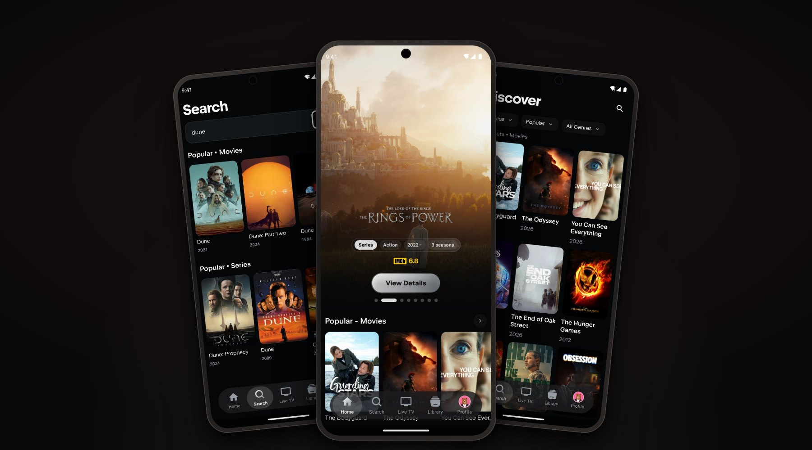
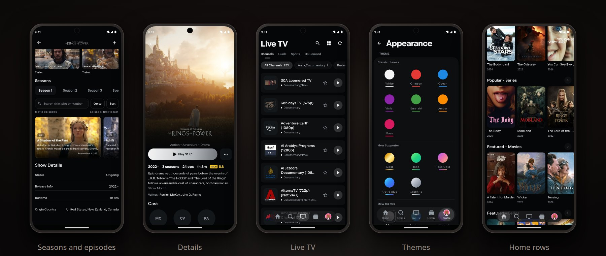
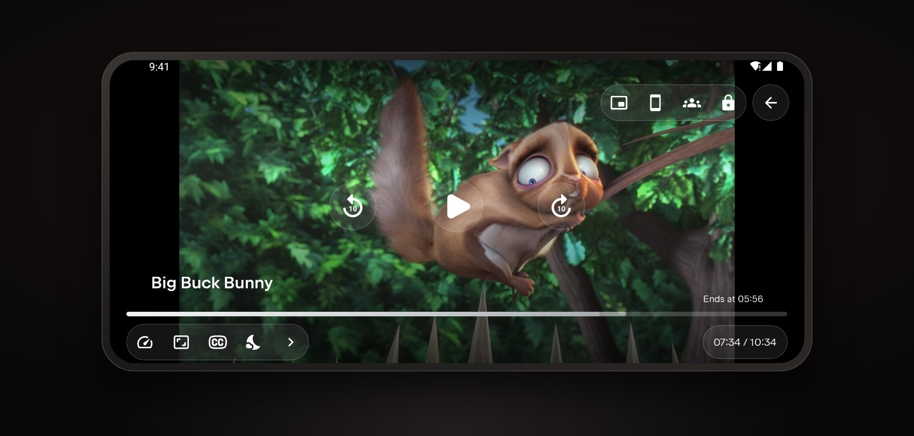

<p align="center">
  
</p>

<h1 align="center">Mew</h1>

<p align="center">
  An Android media client with CloudStream compatibility, Stremio-style addons and Live TV in one app.
</p>

<p align="center">
  <a href="https://github.com/somilkhan/MewMobile/releases/latest"></a>
  <a href="LICENSE"></a>
  <a href="https://github.com/somilkhan/MewMobile/releases"></a>
  
</p>

<p align="center">
  
</p>

<p align="center">
  
</p>

## About

Mew is an independent Android fork of [NuvioMobile Enhanced](https://github.com/AKRusso/NuvioMobile-Enhanced), which is based on [NuvioMobile](https://github.com/NuvioMedia/NuvioMobile). It also integrates the work in [luqmanfadlli/NuvioMobile-Enhanced](https://github.com/luqmanfadlli/NuvioMobile-Enhanced) up to 1.1.0-beta.3, including its settings layout.

Mew ships no content of its own. You add the repositories, providers and addons you trust, and Mew handles browsing, playback, tracking and downloads around them.

## Features

Content sources

- CloudStream repositories and providers through an embedded CloudStream runtime.
- Stremio-style manifest addons. Addons install from a manifest URL or a `stremio://` link.
- Jellyfin and Emby servers.
- Torbox, Premiumize and Real-Debrid accounts.

Browsing

- A Home hero banner with trailer previews, catalog rows and optional smart rows.
- Discover with type, sort and genre filters, plus search across installed sources.
- Details pages with trailers, cast, ratings, season tabs and episode search.

Live TV

- M3U playlists, Xtream and Stalker portals.
- EPG from XMLTV, with Channels, Guide, Sports and On Demand tabs.

Playback

- The Mew player with subtitle selection, subtitle autosync, playback speed and aspect ratio controls.
- Watch Party, a mini player when you leave the player, and picture-in-picture.

Downloads

- A download queue with a Wi-Fi only option, whole-season batches and a custom download folder.

Tracking and accounts

- Trakt, Simkl, MDBList, AniList, MyAnimeList, WeTrakr and PublicMetaDB.
- Multiple profiles with PINs, avatars and profile backgrounds.

Personalization

- Classic, Mew Supporter and Mew themes, or a custom three-color gradient.
- A Mew settings hub for home, hero banner, details page, player and download options, with backup and restore of all Mew settings to a file.
- In-app updates from GitHub Releases on a Stable or Beta channel.

Some features depend on the build variant and on what your installed sources provide.

## Screenshots

<p align="center">
  
</p>

<p align="center">
  
</p>

These are captures of the current build on an Android emulator. The Live TV and player screens use public test streams, and the player frame is from Big Buck Bunny (Blender Foundation, CC BY 3.0).

## Download

Get the latest build from [GitHub Releases](https://github.com/somilkhan/MewMobile/releases/latest). Each release has APKs per CPU architecture:

| APK | Use it for |
| --- | --- |
| `arm64-v8a` | Most phones and tablets from the last several years |
| `armeabi-v7a` | Older 32-bit ARM devices |
| `x86` and `x86_64` | Emulators and x86 devices |
| `universal` | Any device, at a larger download size |

If you are not sure, pick `arm64-v8a`. Pre-releases are Beta builds. The app only offers them to you if you switch to the Beta channel in settings.

## Getting started

1. Install the APK that matches your device.
2. Open Settings, then Content & Discovery.
3. Add a CloudStream repository or an addon manifest you trust. A `stremio://` link opened on the device also works.
4. Turn on the providers or addons you want.
5. Go back to Home or Search and open a title.

For Live TV, add an M3U URL, Xtream login or Stalker portal in the Live TV settings.

## Build from source

You need JDK 17 and an Android SDK with API 37 for compiling. The app targets API 36 and runs on Android 7.0 (API 24) and later. The Gradle wrapper (9.8.2) and Android Gradle Plugin (9.4.0) come with the repository.

```bash
./gradlew :androidApp:assembleFullDebug -Pnuvio.android.distribution=full
```

The APK ends up in `androidApp/build/outputs/apk/full/debug/`. Some Gradle properties, packages and paths still use `nuvio` names. They are internal identifiers, and renaming them would break compatibility with upstream merges.

## Releases

Public builds come from the [Android release workflow](.github/workflows/android-release.yml). Signing keys and API secrets live in repository secrets or in an ignored local config, never in the repository.

A release goes to the Beta channel when the workflow runs with `channel: beta` or when the triggering commit message contains `[release-beta]`. Beta builds are published as GitHub pre-releases. [RELEASES.md](RELEASES.md) has the setup steps and the release checklist.

## Project structure

| Path | Contents |
| --- | --- |
| `composeApp/src/commonMain` | Shared app and UI code |
| `composeApp/src/fullCommonMain` | CloudStream integration for the full distribution |
| `composeApp/src/androidFull` | Embedded Android CloudStream runtime |
| `androidApp` | Android packaging, manifests and release config |
| `composeApp/src/commonTest` | Shared tests |
| `.github/workflows` | CI and release automation |

## Support

If Mew is useful to you, you can support its creator on [TYVM](https://www.thankyouverymuch.co/zehen). It takes UPI in India and cards elsewhere.

## Contributing

Read [CONTRIBUTING.md](CONTRIBUTING.md) before you open a pull request. Keep changes focused, link a reproducible bug, and include test results. UI changes need before and after screenshots. Cosmetic-only changes and feature work that wasn't discussed first won't be merged.

- [Report a bug or request a feature](https://github.com/somilkhan/MewMobile/issues/new/choose)
- [Browse open issues](https://github.com/somilkhan/MewMobile/issues)

## Limitations

- Android is the only published platform right now.
- Third-party repositories, providers and addons can change or disappear at any time, outside Mew's control.
- Some internal identifiers keep their Nuvio names.

## Attribution and licensing

Mew is licensed under [GPL-3.0](LICENSE). It builds on [NuvioMobile](https://github.com/NuvioMedia/NuvioMobile), [NuvioMobile Enhanced](https://github.com/AKRusso/NuvioMobile-Enhanced) and [luqmanfadlli/NuvioMobile-Enhanced](https://github.com/luqmanfadlli/NuvioMobile-Enhanced). Upstream code, the CloudStream runtime and other third-party components keep their own licenses. The in-app Licenses & Attribution page lists them.

<p align="center">
  <sub>Mew is an independent project. It is not the official NuvioMobile or CloudStream app.</sub>
</p>
