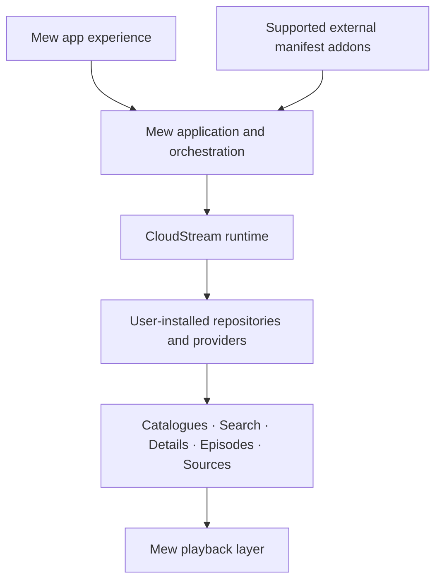

<p align="center">
  
</p>

<h1 align="center">Mew</h1>

<p align="center">
  An Android media client with native CloudStream compatibility and a Mew-owned app experience.
</p>

<p align="center">
  <a href="https://github.com/somilkhan/MewMobile/releases/tag/0.5.1">Latest release: 0.5.1</a>
  ·
  <a href="https://github.com/somilkhan/MewMobile/blob/enhanced/LICENSE">License</a>
  ·
  <a href="https://github.com/NuvioMedia/NuvioMobile">Upstream project</a>
</p>

<p align="center">
  
</p>

<p align="center">
  <a href="https://github.com/somilkhan/MewMobile/releases/latest"></a>
  <a href="https://github.com/somilkhan/MewMobile/blob/enhanced/LICENSE"></a>
  <a href="https://github.com/somilkhan/MewMobile/releases"></a>
  
</p>

---

## Contents

- [About](#about)
- [Highlights](#highlights)
- [Screenshots](#screenshots)
- [Download](#download)
- [Getting started](#getting-started)
- [How it works](#how-it-works)
- [Building from source](#building-from-source)
- [Project structure](#project-structure)
- [Development principles](#development-principles)
- [Contributing](#contributing)
- [Current limitations](#current-limitations)
- [Attribution and licensing](#attribution-and-licensing)
- [Legal](#legal)

---

## About

Mew is an independent Android fork of [NuvioMobile](https://github.com/NuvioMedia/NuvioMobile), developed with its own product identity and user experience. It brings together media discovery, user-managed extensions and playback while retaining compatibility with the CloudStream runtime.

Mew is built around integrations that users choose to install. It does not bundle a central catalogue of streaming providers, and it does not host or distribute media.

## Highlights

- **Native CloudStream compatibility** — use compatible CloudStream repositories and providers through the integrated runtime.
- **User-managed extensions** — add and manage repositories and providers instead of relying on a bundled provider list.
- **External addon support** — connect supported manifest-based addons for catalogs, metadata, streams and subtitles.
- **Flexible discovery** — browse Home, search, details and episode results supplied by installed integrations.
- **Playback options** — multiple playback engines and configurable playback behavior.
- **Subtitle controls** — subtitle selection and synchronization, including support for embedded and sidecar subtitles.
- **Library and profiles** — keep supported library and profile features within the app.
- **Optional metadata enrichment** — services such as TMDB can enrich presentation, but are not required for CloudStream provider content.

Feature availability can depend on the installed integration, build variant and platform.

## Screenshots

<!--
SCREENSHOT GALLERY SLOT
Add real Mew screenshots here when supplied:
- docs/images/screenshots/home.png
- docs/images/screenshots/details.png
- docs/images/screenshots/player.png
- docs/images/screenshots/settings.png

Suggested order: Home, Details, Player, Settings.
Do not replace these with app icons, mockups or screenshots from upstream.
-->

## Download

The latest public Android release is **Mew 0.5.1 (120)**.

[Get Mew 0.5.1 from GitHub Releases](https://github.com/somilkhan/MewMobile/releases/tag/0.5.1)

Choose the APK that matches your device:

| APK | Intended devices |
| --- | --- |
| [arm64-v8a](https://github.com/somilkhan/MewMobile/releases/download/0.5.1/androidApp-full-arm64-v8a-release.apk) | Most modern 64-bit Android phones and tablets |
| [armeabi-v7a](https://github.com/somilkhan/MewMobile/releases/download/0.5.1/androidApp-full-armeabi-v7a-release.apk) | Compatible 32-bit ARM devices |
| [Universal](https://github.com/somilkhan/MewMobile/releases/download/0.5.1/androidApp-full-universal-release.apk) | Broad compatibility; larger download |
| [x86](https://github.com/somilkhan/MewMobile/releases/download/0.5.1/androidApp-full-x86-release.apk) | x86 Android devices |
| [x86_64](https://github.com/somilkhan/MewMobile/releases/download/0.5.1/androidApp-full-x86_64-release.apk) | 64-bit x86 Android devices |

For most current Android phones, choose **arm64-v8a**. If you are unsure which architecture your device uses, use the universal APK.

Only install builds from sources you trust. Review the [release notes](https://github.com/somilkhan/MewMobile/releases/tag/0.5.1) before updating.

## Getting started

1. Install the Android APK for your device.
2. Open **Settings → Content & Discovery**.
3. Add a CloudStream repository or another supported integration that you trust.
4. Enable the providers or addons you want to use.
5. Configure optional metadata services if you want metadata enrichment.
6. Browse Home or Search and open a result supplied by your installed integrations.

Mew does not ship with a guaranteed provider catalogue. Content and source availability depend on the third-party integrations you choose to install and use.

## How it works

Mew keeps its app experience separate from the provider runtime:



CloudStream is the compatibility/runtime layer; it is not a catalogue bundled by Mew. External manifest-based addons are a separate integration path.

### Metadata is optional

CloudStream providers can return content without TMDB. Metadata services can add artwork, descriptions and matching where configured, but they are not a prerequisite for provider content.

## Building from source

### Requirements

- A compatible JDK for the Gradle build.
- Android SDK and the SDK components required by the project.
- Git and the repository's Gradle wrapper.

### Build a full Android debug APK

```bash
./gradlew :androidApp:assembleFullDebug -Pnuvio.android.distribution=full
```

The repository retains some `nuvio.*` Gradle, property and package identifiers for compatibility. These internal identifiers do not change the public product name.

### Release builds

Public release builds are produced through the repository's GitHub Actions release workflow. Signing credentials and other private configuration must be supplied through the configured GitHub Actions secrets or local ignored configuration.

Never commit signing keys, passwords, API secrets or private configuration files.

The Android release version is sourced from `iosApp/Configuration/Version.xcconfig`. Before preparing a release, review the [release workflow](.github/workflows/android-release.yml) and [Android release setup](RELEASES.md).

## Project structure

| Path | Purpose |
| --- | --- |
| `composeApp/src/commonMain` | Shared application and UI code |
| `composeApp/src/fullCommonMain` | Full-distribution CloudStream integration |
| `composeApp/src/androidFull` | Embedded Android CloudStream runtime and platform integration |
| `androidApp` | Android packaging, manifests and release configuration |
| `composeApp/src/commonTest` | Shared tests |
| `.github/workflows` | CI and release automation |

## Development principles

Mew development focuses on four areas:

1. **Mew experience** — maintain the app's own identity and product/UI layer.
2. **CloudStream compatibility** — integrate with the existing CloudStream runtime rather than creating a duplicate provider system.
3. **Reliability** — improve playback, lifecycle behavior, loading and rendering without introducing regressions.
4. **Upstream compatibility** — preserve required compatibility and attribution for inherited components.

Contributions should avoid fake provider data, synthetic catalogues, hardcoded third-party sources or a parallel extension runtime.

## Contributing

Contributions and issue reports are welcome. Before opening a pull request:

- Read [CONTRIBUTING.md](CONTRIBUTING.md).
- Keep changes focused and explain the user-facing or technical reason.
- Include relevant test results and reproduction steps for fixes.
- Do not include credentials, private user data or copyrighted media.
- Preserve existing Mew behavior unless a change is intentional and documented.

## Current limitations

- Mew is currently published as an Android application; capabilities on other targets may differ and should not be assumed to match Android.
- Content availability depends on third-party repositories, plugins and addons installed by the user.
- Third-party integrations can change, become unavailable or fail independently of Mew.
- Optional metadata enrichment may be unavailable without affecting the underlying CloudStream provider architecture.
- Some internal compatibility identifiers retain Nuvio naming.

## Attribution and licensing

Mew is an independent fork of [NuvioMobile](https://github.com/NuvioMedia/NuvioMobile). Upstream code and other third-party components remain subject to their respective licenses and attribution requirements.

- Review the repository's [LICENSE](LICENSE).
- Review applicable third-party notices and the in-app **Licenses & Attribution** section.
- CloudStream compatibility code and the embedded runtime remain subject to their applicable upstream licenses.

## Legal

Mew is a client application. It does not host, provide or distribute media content. Users are responsible for the repositories, plugins, addons, services and content they choose to access, and must use them only where they have authorization.

---

<p align="center">
  <sub>Mew is an independent project and is not the official NuvioMobile or CloudStream application.</sub>
</p>
