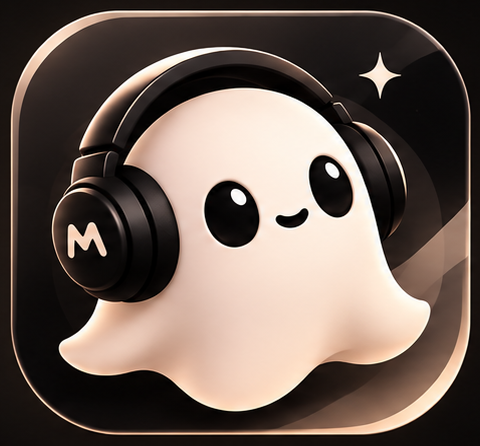
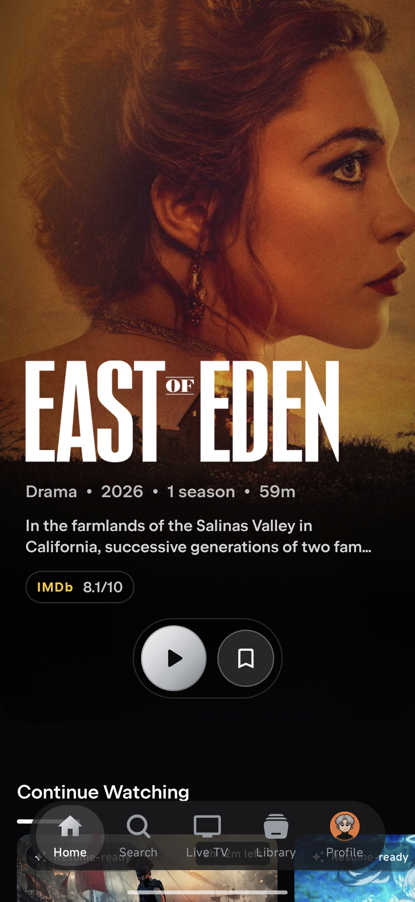
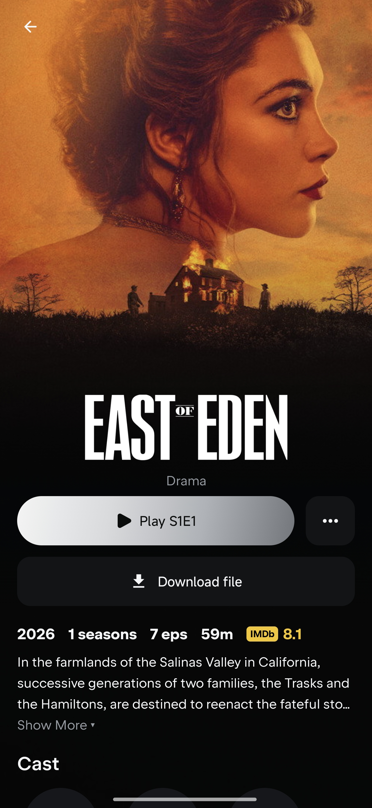
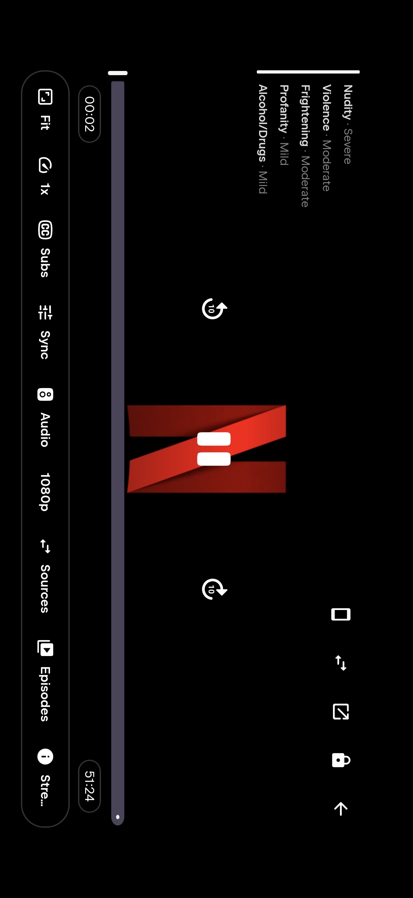
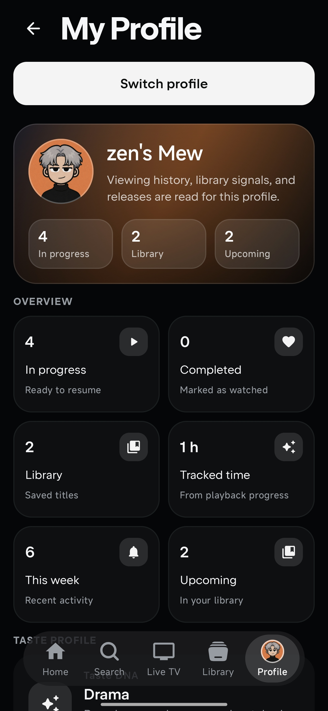
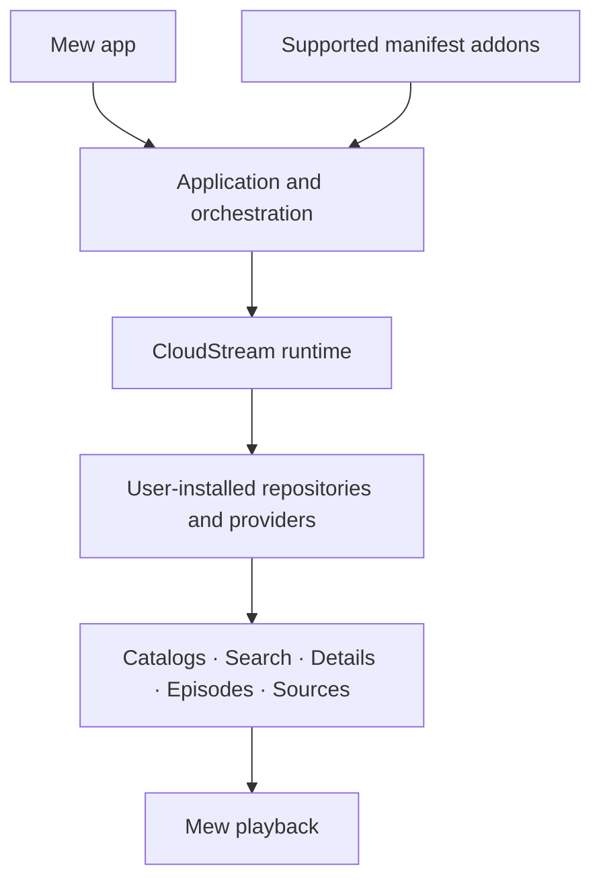

<p align="center">
  
</p>

<h1 align="center">Mew</h1>

<p align="center">
  An Android media client with native CloudStream compatibility and a Mew-owned app experience.
</p>

<p align="center">
  
</p>

<p align="center">
  <a href="https://github.com/somilkhan/MewMobile/releases/latest"></a>
  <a href="https://github.com/somilkhan/MewMobile/blob/enhanced/LICENSE"></a>
  <a href="https://github.com/somilkhan/MewMobile/releases"></a>
  
</p>

---

## Contents

- [About](#about)
- [Highlights](#highlights)
- [Screenshots](#screenshots)
- [Download](#download)
- [Getting started](#getting-started)
- [How it works](#how-it-works)
- [Building from source](#building-from-source)
- [Project structure](#project-structure)
- [Release configuration](#release-configuration)
- [Contributing](#contributing)
- [Limitations](#limitations)
- [Attribution and licensing](#attribution-and-licensing)

---

## About

Mew is an independent Android fork of [NuvioMobile Enhanced](https://github.com/AKRusso/NuvioMobile-Enhanced), which is itself based on [NuvioMobile](https://github.com/NuvioMedia/NuvioMobile). Mew has its own product identity and app experience while retaining compatibility with the CloudStream runtime.

## Highlights

- **CloudStream compatibility** — use compatible repositories and providers through the integrated runtime.
- **User-managed integrations** — add the repositories, providers and supported addons you choose.
- **Discovery** — browse catalogs, search, details and episode results supplied by installed integrations.
- **Playback** — multiple playback engines and configurable playback behavior.
- **Subtitles** — subtitle selection and synchronization, including embedded and sidecar subtitles.
- **Library and profiles** — use supported library and profile features within the app.
- **Optional metadata** — metadata services can enrich presentation but are not required for CloudStream provider content.

Feature availability depends on the installed integration, build variant and platform.

## Screenshots

<p align="center">
  
  
  
  
</p>

## Download

Get the latest Android build from **[GitHub Releases](https://github.com/somilkhan/MewMobile/releases/latest)**.

Release assets include device-specific APKs where available:

- **arm64-v8a** — most modern Android phones and tablets
- **armeabi-v7a** — compatible 32-bit ARM devices
- **Universal** — broader compatibility, with a larger download
- **x86 / x86_64** — Android devices using x86 processors

For most current Android phones, choose **arm64-v8a**. If you are unsure, use the universal APK when it is included in the release.

## Getting started

1. Install the APK that matches your device.
2. Open **Settings → Content & Discovery**.
3. Add a CloudStream repository or another supported integration you trust.
4. Enable the providers or addons you want to use.
5. Browse Home or Search and open a result supplied by your integrations.

Mew does not include a guaranteed provider catalogue. Content and source availability depend on the third-party integrations you install.

## How it works

Mew provides the app experience and connects it to the CloudStream runtime and supported external addons.



CloudStream is the compatibility/runtime layer, not a catalogue bundled by Mew. Metadata enrichment is optional and depends on the services configured by the user.

## Building from source

### Requirements

- JDK 17
- Android SDK with API 37 (compile SDK) and API 36 (target SDK)
- Git and the included Gradle wrapper (Gradle 9.4.1)

The app's minimum Android SDK is 24.

### Build a full Android debug APK

```bash
./gradlew :androidApp:assembleFullDebug -Pnuvio.android.distribution=full
```

Some Gradle properties, package identifiers and compatibility paths retain `nuvio` naming. These internal identifiers do not change the public product name.

## Release configuration

Public Android releases are built through [the GitHub Actions release workflow](.github/workflows/android-release.yml). Release signing material and private configuration must be supplied through the configured repository secrets or local ignored configuration.

See [RELEASES.md](RELEASES.md) for API setup, signing requirements and the release checklist. Never commit signing keys, passwords or API secrets. Publishing a public release requires repository-owner approval and configured secrets.

## Project structure

| Path | Purpose |
| --- | --- |
| `composeApp/src/commonMain` | Shared application and UI code |
| `composeApp/src/fullCommonMain` | Full-distribution CloudStream integration |
| `composeApp/src/androidFull` | Embedded Android CloudStream runtime and platform integration |
| `androidApp` | Android packaging, manifests and release configuration |
| `composeApp/src/commonTest` | Shared tests |
| `.github/workflows` | CI and release automation |

## Support

Support the creator behind Mew and other independent projects through the [TYVM donation page](https://www.thankyouverymuch.co/zehen). Indian supporters can use UPI; international supporters can use supported cards.

## Contributing

Please read [CONTRIBUTING.md](CONTRIBUTING.md) before opening a pull request. Keep changes focused, link reproducible bugs, and include relevant test results. UI fixes require before-and-after proof; cosmetic-only changes and unapproved feature work are not accepted.

- [Report a bug or request a feature](https://github.com/somilkhan/MewMobile/issues/new/choose)
- [Browse existing issues](https://github.com/somilkhan/MewMobile/issues)

## Limitations

- Mew is currently published as an Android application; other targets may differ.
- Third-party repositories, providers and addons can change or become unavailable independently of Mew.
- Some internal compatibility identifiers retain Nuvio naming.

## Attribution and licensing

Mew is an independent fork of [NuvioMobile Enhanced](https://github.com/AKRusso/NuvioMobile-Enhanced), originally based on [NuvioMobile](https://github.com/NuvioMedia/NuvioMobile). Upstream code and third-party components remain subject to their respective licenses and attribution requirements.

See the repository's [GPL-3.0 license](LICENSE), applicable third-party notices and the in-app **Licenses & Attribution** section. CloudStream compatibility code and the embedded runtime remain subject to their applicable upstream licenses.

---

<p align="center">
  <sub>Mew is an independent project and is not the official NuvioMobile or CloudStream application.</sub>
</p>
